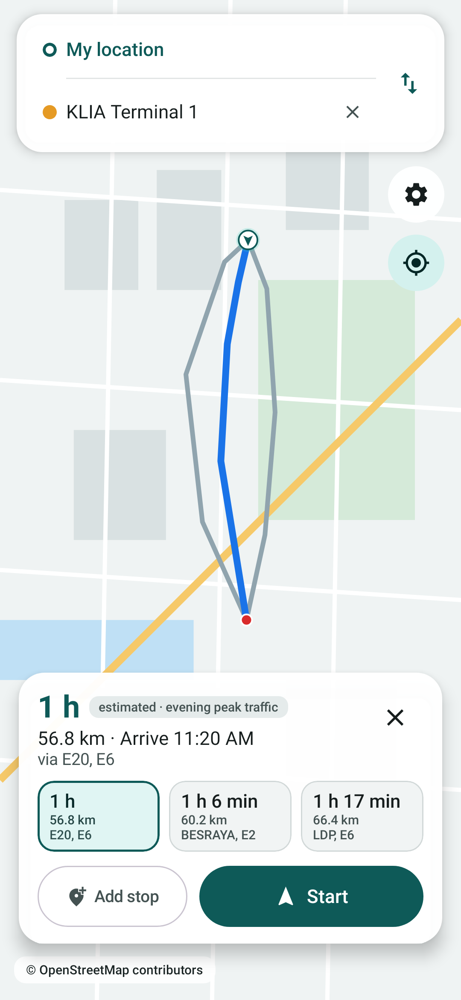
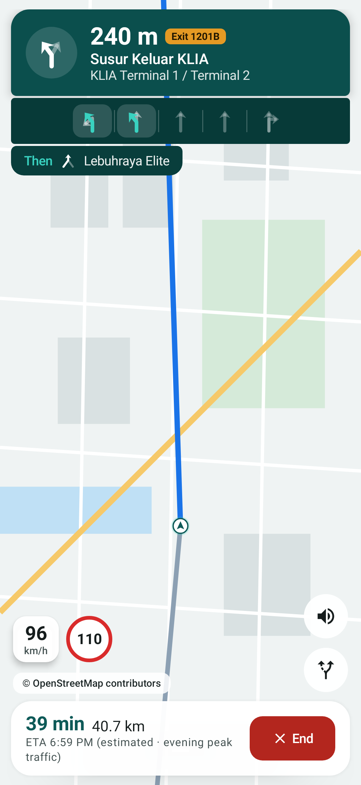
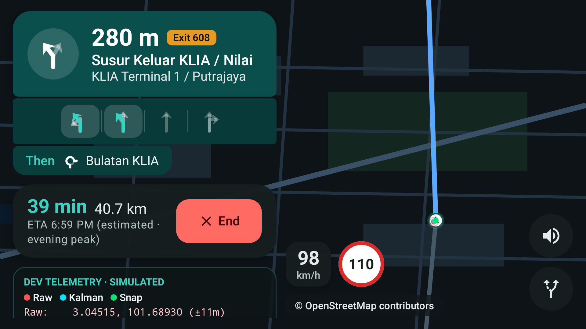
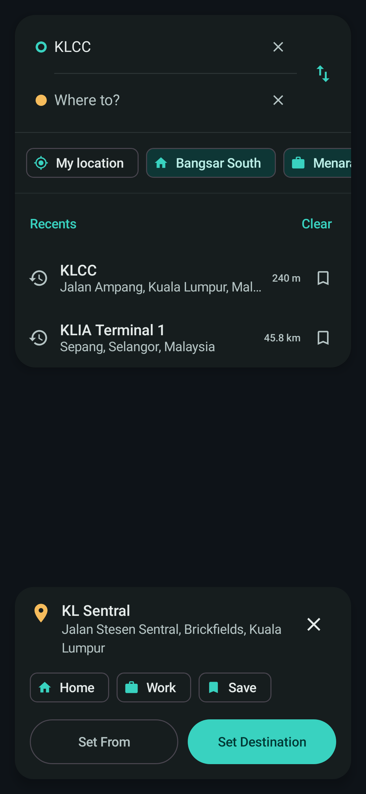
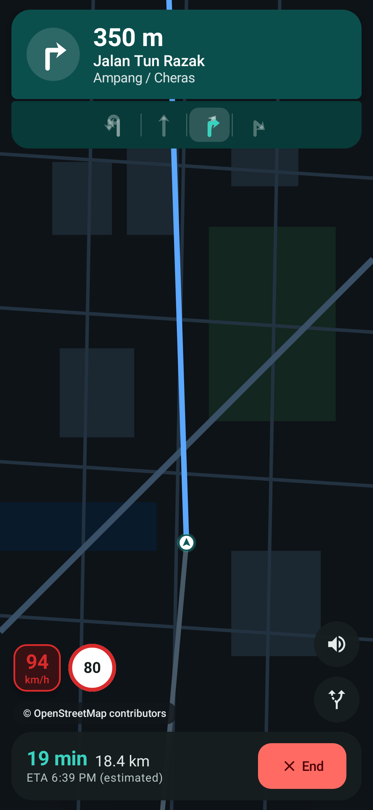
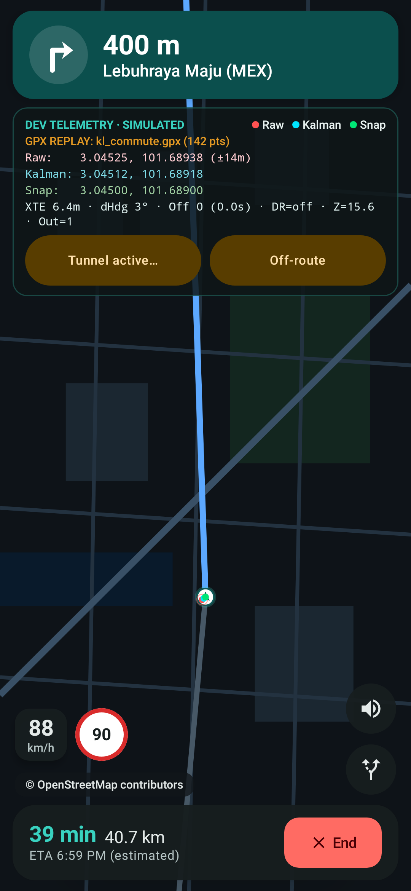

# HalaTuju

**HalaTuju** (`com.mbk.halatuju`) is a production-quality, 100% open-source, keyless turn-by-turn navigation app for Android built on OpenStreetMap data. Designed and verified with **Kuala Lumpur / Klang Valley, Malaysia** as the primary test region while supporting global navigation out of the box.

---

## 100% Open-Source / Open-Data Stack

HalaTuju uses **zero** Google Maps SDKs, **zero** Mapbox proprietary SDKs, **zero** HERE/TomTom dependencies, and **zero** paid or closed API keys. Every external service sits behind a Kotlin interface and can be self-hosted cleanly in Settings.

| Layer | Technology / Default Service | Interface | Notes & Compliance |
|---|---|---|---|
| **Map Renderer** | MapLibre Native Android (`android-sdk-opengl:13.7.1`) | — | 2.5D camera (`45°–60°` pitch), course-up heading, 3D `fill-extrusion` buildings, 60 fps puck interpolation |
| **Vector Tiles** | OpenFreeMap (`Liberty` light + custom [`halatuju_dark.json`](core/map/src/main/assets/halatuju_dark.json)) | [`TileSource`](core/map/src/main/kotlin/com/mbk/halatuju/core/map/TileSource.kt) | 3D buildings in both themes, `User-Agent` header, 64 MB disk cache, configurable URLs (PMTiles / Martin ready) |
| **Routing** | Valhalla (`valhalla1.openstreetmap.de`) | [`Router`](core/routing/src/main/kotlin/com/mbk/halatuju/core/routing/Router.kt) | OSRM format with `bannerInstructions`, `voiceInstructions`, `intersections[].lanes`, `annotation.maxspeed`, `alternates`, avoid tolls/highways/ferries, response cache |
| **Search & Reverse Geocode** | Photon (`photon.komoot.io`) & Nominatim (`nominatim.openstreetmap.org`) | [`Geocoder`](core/geocoding/src/main/kotlin/com/mbk/halatuju/core/geocoding/Geocoder.kt) | Photon ~300 ms debounced + location-biased search; Nominatim reverse-only with strict `>= 1050 ms` rate limiter + cache |
| **Location** | Android `LocationManager` (`GPS_PROVIDER` + `NETWORK_PROVIDER`) | [`LocationSource`](core/location/src/main/kotlin/com/mbk/halatuju/core/location/LocationSource.kt) | Works on de-Googled phones (AOSP/GrapheneOS/LineageOS) with optional [`FusedLocationAdapter`](core/location/src/main/kotlin/com/mbk/halatuju/core/location/LocationSource.kt#L26-L28) boundary |
| **Traffic & ETA** | Valhalla `date_time` + KL Peak Model + Live Pace Adaptation | [`TrafficProvider`](core/routing/src/main/kotlin/com/mbk/halatuju/core/routing/TrafficProvider.kt) | Honest `"estimated"` labeling; detailed in [`docs/TRAFFIC.md`](docs/TRAFFIC.md) |
| **Voice & Audio** | Android `TextToSpeech` + synthesized overspeed chime | [`VoiceGuidancePlayer`](core/voice/src/main/kotlin/com/mbk/halatuju/core/voice/VoiceGuidancePlayer.kt) | Distance/speed-scaled early/medium/final cues, transient ducking audio focus, Bluetooth audio, BM-ready string keys |
| **Attribution & ODbL** | Permanent `"© OpenStreetMap contributors"` + Licenses screen | — | Always visible on the map surface; full notices in About & Open-Source Licenses |

> **Navigation Core Decision:** We evaluated Stadia Maps Ferrostar (`0.59.0`, BSD-3) and authored a pure-Kotlin navigation engine in `:core:navigation` (see [`docs/SPEC.md`](docs/SPEC.md#2-navigation-core-evaluation-ferrostar-vs-custom-engine)) so ENU Kalman filtering, circular bearing smoothing, forward-monotonic snap corridors, N-fix/6 s off-route hysteresis, tunnel dead reckoning, and auto-zoom hysteresis are directly JVM unit-tested and exposed in the Developer telemetry overlay.

---

## Core Capabilities

- **Calm, Adaptive Material 3 UI (Light / Dark / System):** Home floating card (`From` defaulting to `"My location"`, `Where to?`, swap), focused-only Recents & Home/Work Favorites (Room), dropped-pin reverse geocode, Route Preview with up to 3 alternatives, Add/Reorder/Remove multi-stop itineraries, and big Start CTA.
- **2.5D Camera & Auto-Zoom:** Course-up `45°–60°` pitch, lower-third puck framing, dimmed traveled vs bright active polyline, 60 fps interpolation, speed-based zoom (`<= 35 km/h` city detail to `>= 80 km/h` highway horizon) with hysteresis + 300 m maneuver zoom-in, Overview & Recenter controls.
- **Turn-by-Turn Banner, Dynamic Lanes & Speed Limit:** Custom vector maneuver glyphs, signpost/exit badges, `"Then ..."` chip, roundabout exit badges, multi-indication gantry lane strip (hidden gracefully when OSM lacks lane tags), regulatory speed limit circle (hidden when unknown), and single-chime overspeed alert with hysteresis.
- **ENU Kalman Filter, Snapping, Off-Route & Dead Reckoning:** 4-state ENU filter weighted by accuracy with jump/Mahalanobis outlier rejection; circular bearing smoother holding below `2 m/s`; forward-monotonic snapping within `max(25 m, 2×acc)` and `<= 45°` heading match; 5-fix + 6 s off-route rerouting hysteresis; tunnel dead reckoning with `"GPS signal weak"` indicator.
- **Android 16 Live Updates & Wake-Lock:** Location foreground service posting `NotificationCompat.ProgressStyle` + `setRequestPromotedOngoing(true)` on API 36+ with standard ongoing fallback on API 26–35, throttled updates, `End` action receiver, runtime permission flow, and `FLAG_KEEP_SCREEN_ON` scoped strictly to foreground active navigation.
- **Simulation, GPX Replay/Record & Developer Overlay:** Simulated drives (`1x`/`2x`/`4x` with optional Gaussian GPS noise, synthetic tunnel dropouts, and deliberate off-route detours) plus GPX 1.1 import/export running through the identical production navigation, voice, speed, and notification pipeline.
- **Multi-Device & Accessibility:** `WindowSizeClass` responsive layouts (`360×640` compact phones, large phones, unfoldables, landscape side rail, tablets), edge-to-edge cutout/gesture insets, verified `200%` font-scale legibility & `>= 48 dp` touch targets, and TalkBack semantics.

---

## Modular Architecture

```text
:app                  MainActivity, Hilt DI graph, foreground service notifications, NavHost
├── :core:model       Domain models, geo math, AppInfo & configurable ServiceEndpoints
├── :core:storage     Room database (RecentPlace, FavoritePlace) & DataStore AppSettings
├── :core:location    LocationSource, LocationManager GPS+Net, SimulatedLocationSource, GPX 1.1 I/O
├── :core:map         TileSource, OpenFreeMap Liberty & custom 3D dark style, MapLibre canvas
├── :core:routing     Router, ValhallaRouter (OSRM/lanes/maxspeed), TrafficProvider, KL peak model
├── :core:geocoding   Geocoder, PhotonGeocoder (300 ms debounce + bias), NominatimGeocoder (1 req/s)
├── :core:navigation  EnuKalmanFilter, BearingSmoother, RouteSnapper, OffRouteDetector, AutoZoom, Session
├── :core:voice       VoiceCueFormatter, SpeechQueueCoordinator, AudioFocusCoordinator, Chime, AndroidTts
├── :feature:search   HomeSearchCard, DroppedPinCard, RoutePreviewSheet, SearchViewModel
├── :feature:navigation ActiveNavigationScreen, ManeuverIcon, LaneGuidanceStrip, DebugOverlay, FGS notification
└── :feature:settings SettingsScreen, ServiceEndpointsDialog, Simulation & GPX UI, AboutLicensesScreen
```

---

## Screenshots (Rendered via Roborazzi API 36)

| Search & Route Preview | Active 2.5D Navigation & Lanes | Landscape / Tablet / Debug HUD |
|---|---|---|
|  |  |  |
|  |  |  |

---

## Build, Verification & Self-Hosting

Requirements: JDK 21, Android SDK (`compileSdk = 37`, `minSdk = 26`).

```bash
# Unit tests (JVM + Robolectric)
./gradlew testDebugUnitTest

# Verify Roborazzi UI screenshots across phones, foldables, tablets & 200% font scale
./gradlew verifyRoborazziDebug

# Android Lint & Debug / Release APKs
./gradlew lintDebug assembleDebug assembleRelease

# Compile Android instrumented tests (runs on KVM API 36 & API 34 emulators in CI)
./gradlew :app:compileDebugAndroidTestKotlin
```

- **Technical Specification:** [`docs/SPEC.md`](docs/SPEC.md)
- **Self-Hosting Valhalla, Tiles & Geocoding (Docker + Geofabrik Malaysia):** [`docs/SELF_HOSTING.md`](docs/SELF_HOSTING.md)
- **Traffic Model & Extension Points:** [`docs/TRAFFIC.md`](docs/TRAFFIC.md)
- **Milestones & Verified Status:** [`docs/PLAN.md`](docs/PLAN.md) · [`docs/STATUS.md`](docs/STATUS.md)

---

## Data & Open-Source Attribution

Map tiles, road networks, speed limits, and place data © [OpenStreetMap contributors](https://www.openstreetmap.org/copyright), available under the Open Database License (ODbL 1.0). See in-app **Settings → About & Open-Source Licenses** for full library notices.
